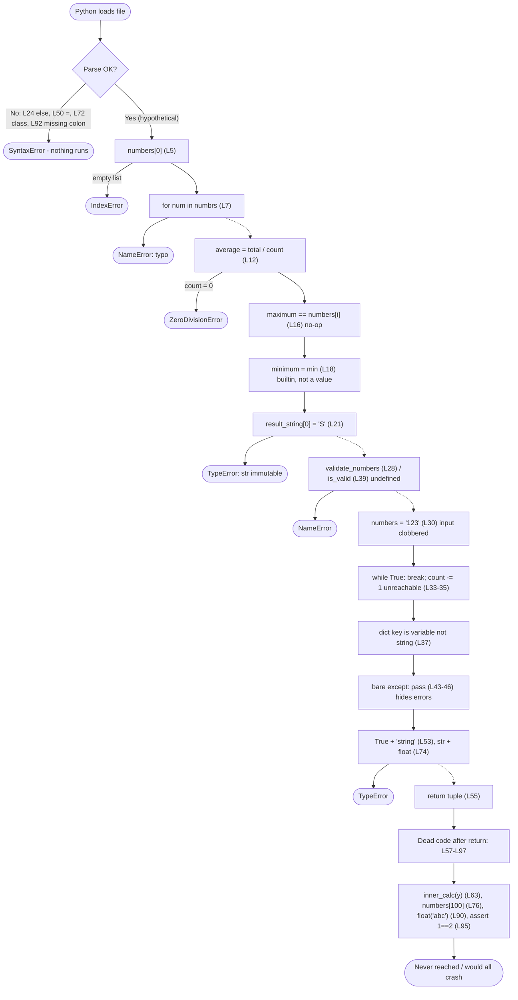
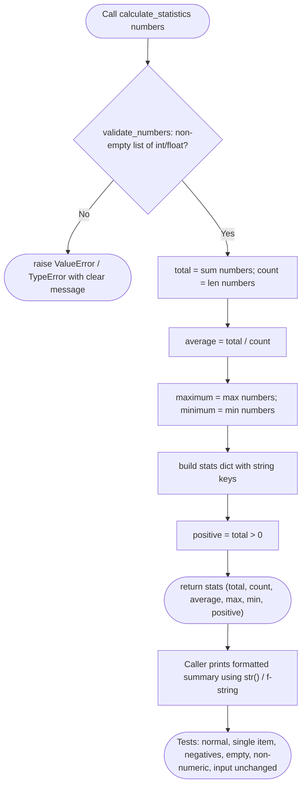

# CS-530 Module 3 — `calculate_statistics` Repair Plan

Status: **PLAN ONLY — no code has been changed.**
Source: `CS 530 Module Three Activity Code Snippet(1).txt` (95 lines; line numbers below refer to it).
Evidence: `ast.parse` fails at line 24 (`else:` misplaced), so the file cannot run at all today. Python reports syntax errors one at a time, so P0 must clear *all* of them before any runtime bug is even visible.

## 1. Intended behavior (acceptance criteria)

`calculate_statistics(numbers)` should take a non-empty list of numbers and return the total, count, average, maximum, and minimum.

- Empty or invalid input is rejected with a clear error, not an IndexError or ZeroDivisionError.
- Input is never mutated or reassigned to another type.
- No unreachable code, no swallowed exceptions, no shadowed builtins.
- Calling `calculate_statistics([1, 2, 3, 4, 5])` returns average 3.0, max 5, min 1 and prints nothing unexpected.

## 2. Process flow — CURRENT code

## 3. Process flow — TARGET code

## 4. Repair register

Priority key: **P0** = file will not parse. **P1** = crashes or wrong result at runtime. **P2** = dead code, hygiene, and quality.

### P0 — Syntax blockers (Gate 0)

| ID | Line | Defect | What it does today | Planned repair |
|---|---|---|---|---|
| R01 | 23-26 | `else:` indented inside the `if` body | SyntaxError, parser stops here | Dedent `else` to align with `if total > 0:` (or replace with `positive = total > 0`) |
| R02 | 50 | `if average = maximum:` | SyntaxError, assignment in condition | Use `==` (and decide if the check is even needed) |
| R03 | 72 | `class = "stats"` | SyntaxError, reserved keyword | Rename variable, e.g. `label` |
| R04 | 92 | `if total > 0` missing colon | SyntaxError | Add `:` (or remove duplicate block, see R20) |
| R05 | 61 | Nested `def inner_calc` body after `return` is parsed but sits mid-function | Not a parse error, but flagged here because it hides inside unreachable code and is cleaned in P2 | Handled in R19 |

Gate 0 exit: `python -m py_compile file.py` passes with no errors.

### P1 — Runtime and logic defects (Gate 1)

| ID | Line | Defect | What it does today | Planned repair |
|---|---|---|---|---|
| R06 | 5 | `numbers[0]` on empty list | IndexError | Validate input first; raise `ValueError` if empty |
| R07 | 7 | `numbrs` typo | NameError | Use `numbers` (or `sum()`) |
| R08 | 12 | Division by `count` with no guard | ZeroDivisionError on empty input | Covered by R06 validation |
| R09 | 16 | `maximum == numbers[i]` | Comparison with no effect; max never updates | Use `=`, or simply `max(numbers)` |
| R10 | 18 | `minimum = min` | Stores the builtin function, not a value | `minimum = min(numbers)` |
| R11 | 20-21 | Item assignment on a string | TypeError | Remove; build strings with f-strings |
| R12 | 28, 39 | `validate_numbers` and `is_valid` undefined | NameError | Define `validate_numbers` (returns/raises) and use its result or drop `is_valid` |
| R13 | 30 | `numbers = "123"` reassigns the parameter to a string | Breaks every later use of `numbers` (R14-R16, R22-R24) | Delete; never rebind input |
| R14 | 37 | `{average: "avg", ...}` | Key is the numeric value, not the string `"avg"` | Quote keys: `{"avg": average, "max": maximum}` |
| R15 | 43-46 | Bare `except: pass` on `numbers[0] / 0` | Hides a guaranteed error; also traps KeyboardInterrupt | Remove the intentional bad division; if a try is needed, catch a specific exception and handle it |
| R16 | 53 | `True + "string"` | TypeError | Remove (leftover test line) |
| R17 | 74 | `"Avg: " + average + ...` | TypeError, str + float | f-string: `f"Avg: {average} Max: {maximum}"` |
| R18 | 55 | `return "average", average, maximum, minimum` | Returns an unlabeled tuple with a stray string; `total`/`count` dropped | Return a dict or named tuple with all stats |
| R19 | 59-63 | `inner_calc` does `5 + "10"`, called as `inner_calc(y)` with `y` undefined and no param | TypeError / NameError, and unreachable | Delete the nested function (no purpose) |
| R20 | 76, 78, 88, 90, 95 | `numbers[100]`, `numbers[0] -= 1`, `numbers.append(5)`, `float("abc")`, `assert 1 == 2` | Each is a deliberate crash (IndexError, TypeError, AttributeError, ValueError, AssertionError) | Remove from function; move to tests as expected-failure cases if desired |
| R21 | 32-35 | `while True` with `break` before `count -= 1` | Infinite loop if `count == 0`; decrement is unreachable | Remove loop (it has no purpose) |
| R22 | 48 | `range(len(numbers))` squares | Squares indexes, not values | `[x * x for x in numbers]` if squares are wanted, else remove |

Gate 1 exit: `calculate_statistics([1,2,3,4,5])` returns the right values; empty list and non-numeric input raise clear errors.

### P2 — Cleanup, quality, and verification (Gate 2)

| ID | Line | Defect | What it does today | Planned repair |
|---|---|---|---|---|
| R23 | 57-97 | Everything after `return` | Dead code | Delete |
| R24 | 65 | `average and maximum or minimum` | Truthiness chain, wrong for 0 values, result unused | Remove or replace with explicit logic |
| R25 | 67-70 | Triple nested `if numbers / != None / len > 0` | Redundant checks, `process` unused | Collapse into the R06 validation |
| R26 | 80-81 | `import os` inside function; `path` unused | Clutter | Delete |
| R27 | 83-84 | Loop variable reassigned (`i = i - 1`) | No effect on loop | Delete |
| R28 | 86 | `sum = "total"` | Shadows builtin `sum` | Delete (or use a different name) |
| R29 | 50-51 | `average == maximum` print "Equal" | Meaningless comparison, debug output | Delete |
| R30 | 92-93 | Duplicate `if total > 0` / print "Positive" | Redundant with R01 | Delete |
| R31 | 97 | Module-level call with unused `result` | Runs on import | Guard with `if __name__ == "__main__":` and print result |
| R32 | whole | No docstring, type hints, or tests | Nothing proves it works | Add docstring, hints, and 5-6 unit tests |
| R33 | 6, 14-16 | Manual loops for total/max/min | Verbose | Use `sum`, `max`, `min` |

Gate 2 exit: tests pass, `pyflakes`/`ruff` clean, no dead code, side-effect-free import.

## 5. Gate workflow (one at a time)

| Gate | Scope | Items | Verify with | Done when |
|---|---|---|---|---|
| **G0 (P0)** | Make the file parse | R01-R05 | `python -m py_compile` | Zero SyntaxErrors |
| **G1 (P1)** | Make it correct | R06-R22 | Run sample call + empty/bad input | Correct output, clear errors, no crashes |
| **G2 (P2)** | Make it clean | R23-R33 | Unit tests + linter | Tests green, linter clean |

Rule: do not start a gate until the previous gate's exit check passes. Commit after each gate so you can compare diffs against the flows above.

## 6. Assumptions and notes

- The "Bug N" comments in the snippet (2, 6, 10, 14, 18, 21, 26) are the assignment's labeled bugs; the unlabeled ones are listed here too.
- Intended return shape is assumed to be total/count/average/max/min. Confirm with your assignment prompt if it specifies a different output.
- "Master Chief" is not an available skill in this environment (only a research doc exists in `research/`, unrelated to this code), so this plan uses the Jarvis workflow only.
