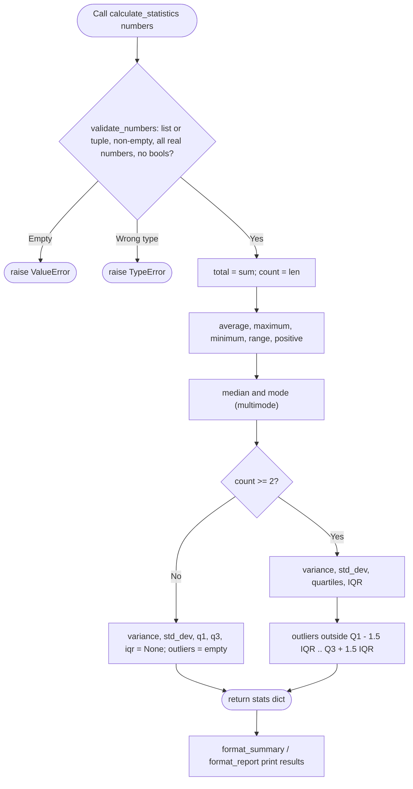

# Module 3 — `calculate_statistics`

## What the function is meant to do

`calculate_statistics(numbers)` takes a non-empty list or tuple of real numbers
(int or float; bools and strings are rejected) and returns a dictionary of
descriptive statistics. It never modifies its input.

| Key | Meaning |
|---|---|
| `total`, `count` | Sum and number of values |
| `average` | Arithmetic mean |
| `maximum`, `minimum`, `range` | Extremes and their spread |
| `median`, `mode` | Middle value; list of most common value(s) |
| `variance`, `std_dev` | Sample variance and standard deviation (`None` if fewer than 2 values) |
| `q1`, `q3`, `iqr` | Quartiles (inclusive method) and interquartile range (`None` if fewer than 2 values) |
| `outliers` | Values outside Q1 − 1.5×IQR or Q3 + 1.5×IQR |
| `positive` | `True` when the total is greater than 0 |

Errors: empty input raises `ValueError`; non-list input or non-numeric items
raise `TypeError`.

Helpers: `validate_numbers(numbers)`, `format_summary(stats)`, `format_report(stats)`.

## Current process flow



## Run and test

```
python calculate_statistics.py       # demo
python -m unittest -q                # 9 unit tests
python simulate_statistics.py        # 5000 random datasets + bad inputs
```

## Repair history

See `docs/week3-repair-plan.md`: gate G0 fixed syntax errors, G1/G2 fixed
runtime bugs and cleaned up, and G3 added the descriptive-statistics enhancements.
